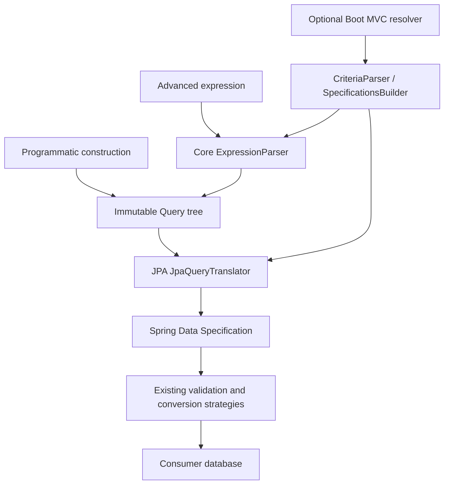

# Architecture

Pembana Search has three library modules under a parent/aggregator POM. All
handwritten production and test packages use JSpecify nullability checking.
Maven runs on OpenJDK 21.0.8+ and emits Java 17 bytecode.

| Artifact (`com.pembana`, version `1.0.0-SNAPSHOT`) | Dependencies and responsibility |
| --- | --- |
| `pembana-search-core` | ANTLR 4.13.1 and JSpecify; immutable models, expression parsing, parser policy and diagnostics |
| `pembana-search-data-jpa` | Core, Spring Data JPA, Jakarta Persistence, Spring Web and Jackson 2; specification translation and inherited conversion strategies |
| `pembana-search-spring-boot-starter` | JPA module and Boot JPA/MVC starters; optional request binding and auto-configuration |

The parent `pembana-search` is a POM, not a runtime JAR. No artifacts have been
published. JPA providers and database drivers are not core dependencies. The JPA
adapter retains Spring Web solely for compatible `ResponseStatusException` and
ProblemDetail diagnostics; it has no MVC resolver or Boot dependency in its main
graph. Jackson 2 remains for inherited Date conversion. Testcontainers, drivers
and shared fixture JAR dependencies remain test-scoped.

## Immutable model and compatibility

`com.pembana.search.core.Query` is sealed: `Comparison`, `Membership`, `Junction`
and `Negation` are records. Strings, enums, recursively immutable child nodes
and defensively copied lists prevent later mutation. `and`, `or` and `not`
compose trees directly. Membership preserves item ordering and empty-list
semantics. Ranges normalize into inclusive comparison pairs; NOT BETWEEN negates
the whole pair. Grouping and the existing grammar's Boolean precedence are
preserved, rather than applying a new precedence rule.

`SearchOptions` and `CaseSensitivity` live in core and are separate from tree
values/grouping. JPA resolves per-property choices before global choices and the
annotation fallback. Explicit choices consistently cover String membership and
ordering; inherited defaults preserve the existing compatibility policy.

Scalar and membership values remain unconverted text until the JPA adapter
resolves an entity attribute's type. This avoids pretending that an unconfigured
parser knows an application's schema. Programmatic operators are explicit:
`STARTS_WITH` with `"Ada"` corresponds to parsed `name:Ada*`. A literal value
containing `*` is not implicitly reparsed or treated as an operator.

`ParserOptions` copies field allow/deny lists and retains the default unlimited
expression-size/nesting policy. Core failures expose `DiagnosticCode`, reason,
optional field and source location through `QueryParseException`, with no HTTP
status dependency. The JPA facade maps these to the established
`InvalidSearchQueryException` code, reason and ProblemDetail location properties.
The JPA translator applies field restrictions to programmatic leaves too.
Character/nesting limits apply to expression strings, not programmatic trees.

`CriteriaParser`, `SpecificationsBuilder.withSearch`, `SearchCriteria`, existing
strategies and `QueryVisitorImpl` remain available in the JPA module. The visitor
is a compatibility facade over the shared core visitor and JPA translator;
there is no second matching implementation. `withQuery` replaces the current
specification just as `withSearch` does, without string concatenation or reparsing.
Mandatory authorization scopes, entity aliases, joins, transactions and pagination
remain consumer responsibilities; this split adds no improved matching policy.

## Optional starter and test boundaries

Boot imports `ResolverConf` only when servlet MVC is available. Applications can
replace the named `pembanaSearchSpecificationResolver` bean with their own
`HandlerMethodArgumentResolver`, or exclude the auto-configuration and register
an application-owned `WebMvcConfigurer`. The default resolver still returns null
for missing/exactly empty searches and does not impose authorization scopes.

The JPA module owns the original 113-test corpus and JPA characterization tests.
A test-scoped fixture JAR shares entities and configuration with starter tests;
it is never a runtime dependency. One HTTP characterization method moves to
`MvcQueryBehaviorTest`; all original inputs and assertions remain intact.
Core tests run without a framework or database, and JPA tests run without the
starter on their classpath. Each module retains the 80% instruction / 75% branch
coverage gates. See [module verification](modules/README.md).

## Request binding

`@SearchSpec` retains query/form binding. `@SearchRequestBody` explicitly selects
a strict JSON envelope, preserving existing endpoints that own unrelated
`@RequestBody` payloads. The starter translates both transports into immutable
core options. It uses the application's Jackson 3 mapper constraints while always
rejecting duplicate keys/trailing documents. Option keys must occur in the query;
JPA validates explicit property choices against actual attribute types. Core
remains free of Jackson and Spring dependencies. See the
[case guide](reference/case-sensitivity.md).
